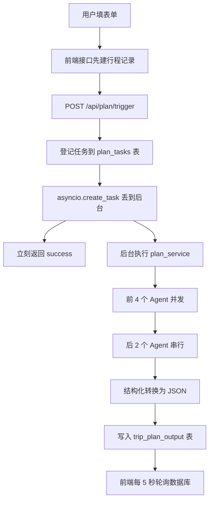

# ✈️ TripCraft AI

**输入旅行需求，6 个 AI Agent 协作生成完整行程方案。**

> ### ⚠️ 来源说明
>
> 本项目基于开源项目 [Shubhamsaboo/awesome-llm-apps](https://github.com/Shubhamsaboo/awesome-llm-apps)
> 中的 `advanced_ai_agents/multi_agent_apps/agent_teams/ai_travel_planner_agent_team` 改造而来（原作者
> [Amit Wani (@mtwn105)](https://github.com/mtwn105)）。
>
> **本仓库记录的是我在原版基础上做的改造与优化** —— 详见下一节。

---

## 🔧 我做了什么（My Contributions）

### 1. 模型方案替换：本地 Ollama → 云端 DeepSeek

原版依赖本地运行的 Ollama + qwen2.5:3b，存在两个问题：小模型输出结构化 JSON 不稳定、本地部署门槛高。
我把模型换成 **DeepSeek-Flash（云端 API）**，只改 `config/llm.py` 与 `.env` 两处即可完成全项目切换
（6 个 Agent 共用同一个 model 实例）。

**连带收益**：云端模型能稳定输出结构化数据，原先为"伺候小模型"而写的三层手工兜底逻辑
（405 行，含正则抠 JSON、逐字符平衡括号等）**精简到 134 行**，直接复用 Agno 自带的 `output_schema` 能力。

### 2. Agent 编排并发优化：串行 → 并发/串行混合

原版 6 个 Agent 全程串行。我分析了它们之间的依赖关系：

- **前 4 个**（目的地调研 / 航班 / 酒店 / 餐厅）只依赖同一份用户需求，彼此互不依赖 → **可以并发**
- **后 2 个**（逐日行程 / 预算优化）需要读取前面的累积结果，必须等 → **保持串行**

据此把前 4 个改用 `asyncio.gather` 并发执行：

```python
(
    destination_research_response,
    flight_search_response,
    hotel_search_response,
    restaurant_search_response,
) = await asyncio.gather(
    destination_agent.arun(destination_prompt),
    flight_search_agent.arun(flight_prompt),
    hotel_search_agent.arun(hotel_prompt),
    dining_agent.arun(restaurant_prompt),
)
```

**实测收益**：4 个真实 Agent 并发调用耗时 **4.0 秒**，串行约需 **16.2 秒**。

**取舍说明**：并发期间进度提示只能显示一条总状态（原来是"正在搜索航班""正在搜索酒店"这种细粒度），
属于用进度粒度换取响应速度。

### 3. 兜底逻辑缺陷修复

项目在模型输出异常时会走**确定性模板兜底**（不依赖 AI，用固定模板拼一份结构合法的 JSON）。
但我发现该模板存在缺陷：**每一天的 `date` 都是同一个出发日期**，4 天行程会显示成 4 个相同日期。

修复方式：新增 `_shift_date(start, offset_days)`，用 `strptime + timedelta + strftime` 按天递增；
同时考虑到用户填写的日期是自由文本（可能是 `next week` 或空串），用 `try/except` 兜住解析失败 ——
解析不了就退回原值，保证兜底函数自身不会抛异常。

```python
def _shift_date(start: str, offset_days: int) -> str:
    """把开始日期往后推 offset_days 天；解析不了就原样返回。"""
    try:
        d = datetime.strptime(start, "%Y-%m-%d")
        return (d + timedelta(days=offset_days)).strftime("%Y-%m-%d")
    except Exception:
        return start
```

另外修复了一处复制粘贴 bug：budget 阶段追加到汇总文本时标题错写成 `## Day-by-day itinerary:`。

### 4. 启动与工程化优化

- **前端启动提速**：`start.ps1` / `.vscode/tasks.json` 里漏了 `--turbopack` 参数，
  而 `client/package.json` 的 dev 脚本本来是带它的 —— 补上后前端启动明显变快
- **启动脚本卡死修复**：原脚本用 `Test-NetConnection` 探测端口，它会先 ping 再测端口，
  在有虚拟网卡/VPN 的机器上会长时间卡住甚至误判 → 改为纯 TCP 连接检测

### 5. 代码清理

清理了无人调用的死代码（`agents/team.py`、`tools/kayak_flight.py`、
`trip_plan_repository.py` 中 5 个未被引用的查询函数等），并精简了冗余注释。

---

## 📖 项目简介

旅行规划很繁琐 —— 要开一堆标签页、比对互相矛盾的信息、花几个小时才能理出头绪。
TripCraft AI 用一个多智能体系统解决这个问题：描述你的理想旅行，它会自动处理
目的地调研、航班、酒店、餐厅、逐日行程和预算。

**核心特性**

- **个性化规划** —— 根据旅行风格与兴趣定制
- **多智能体协作** —— 6 个专职 Agent 分别负责不同领域
- **结构化输出** —— 生成结果落库供前端渲染
- **异步执行** —— 接口秒回，后台生成，前端轮询进度

---

## ⚙️ 工作流程



**关键设计**

1. **接口秒回** —— 生成一次行程要几分钟，接口层用 `asyncio.create_task` 把重活丢到后台，
   立刻返回"已受理"，前端通过轮询状态表获取进度
2. **两层容错** —— 内层换提示词重试 3 次（求质量），外层确定性模板兜底（保可用）
3. **状态可见** —— 每跑一步都更新 `current_step`，前端据此显示实时进度

---

## 🛠️ 技术栈

| 层 | 技术 |
|---|---|
| 前端 | Next.js + React + TypeScript + Prisma |
| 后端 | Python + FastAPI + SQLAlchemy（异步）+ asyncpg |
| AI 框架 | Agno（多智能体编排） |
| 大模型 | DeepSeek（原版为 Gemini） |
| 外部工具 | Exa（联网搜索）、Firecrawl（网页抓取）、Google Flights |

**6 个 Agent**：目的地调研 → 航班搜索 → 酒店搜索 → 餐厅搜索 → 逐日行程 → 预算优化

---

## 🚀 快速开始

### 环境要求

- Python 3.10+
- Node.js 18+
- PostgreSQL 14+

### 配置

在 `backend/` 下创建 `.env`（参考 `backend/.env.example`）：

```bash
DEEPSEEK_API_KEY=your_deepseek_api_key
EXA_API_KEY=your_exa_api_key
FIRECRAWL_API_KEY=your_firecrawl_api_key
DATABASE_URL=postgresql://user@127.0.0.1:5432/your_db
```

### 启动

```bash
# 后端
cd backend
pip install -r requirements.txt      # 或用 pyproject.toml
python main.py                        # 监听 8000 端口

# 前端
cd client
npm install
npm run dev                           # 监听 3000 端口
```

启动后访问 `http://localhost:3000`，接口文档在 `http://localhost:8000/docs`。

---

## 📁 目录结构

```
backend/
  agents/            6 个 Agent 定义 + 结构化输出转换
  services/          业务主流程（plan_service.py）+ 数据库连接
  repository/        数据访问层
  models/            数据模型（输入 / 输出 / 表结构）
  router/            接口路由
  tools/             给 Agent 用的外部工具
  config/            模型与日志配置
client/              前端（Next.js）
```

---

## 🙏 致谢

- 原项目：[Shubhamsaboo/awesome-llm-apps](https://github.com/Shubhamsaboo/awesome-llm-apps)
- 原作者：[Amit Wani (@mtwn105)](https://github.com/mtwn105)

原项目的截图与演示视频请见原作者仓库；本仓库聚焦于我做的改造与优化。
